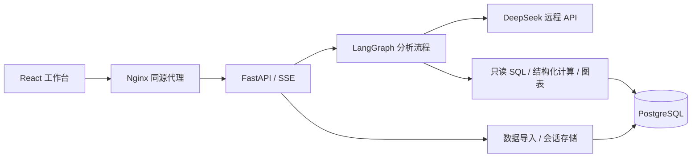
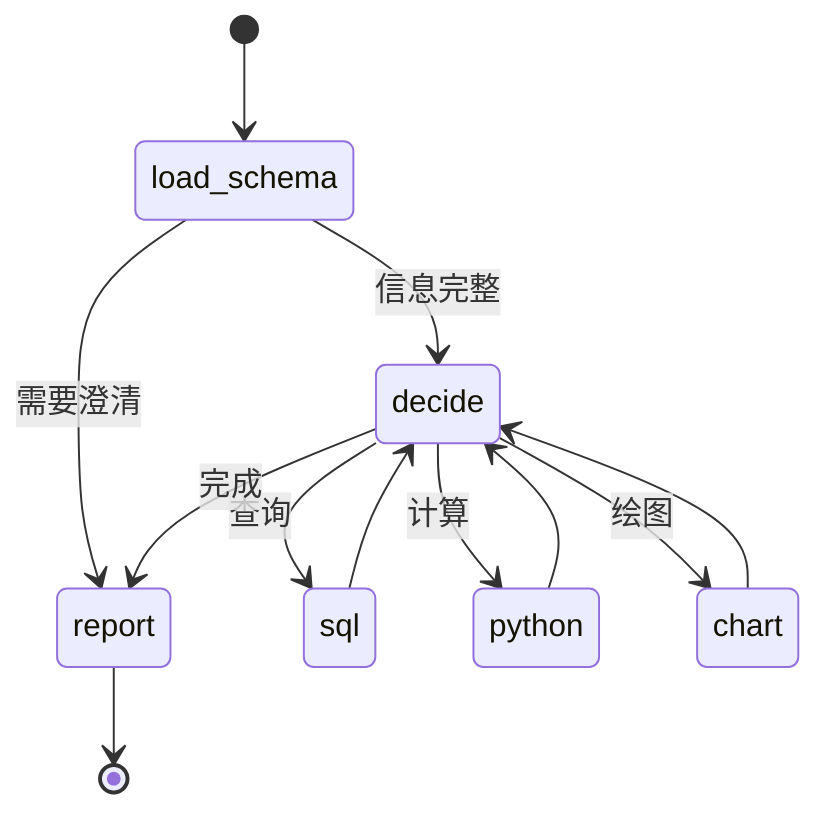

# 洞察 · 数据分析 Agent

一个基于 **LangGraph、FastAPI、DeepSeek、PostgreSQL 和 React** 构建的本地数据分析工作台：上传 CSV / Excel，用自然语言查询数据、分析趋势与维度贡献，通过图表和多轮追问继续探索，并且**每个数字都能追溯到查询证据**。

项目的定位是"窄而深"：不追求大而全的建模能力，而是把**单表可加总指标**的分析做到可靠、可核验——查询经白名单校验，归因明细与独立总额核对，未核实的内容不进入结论，能力边界与限制被明确标注。适合电商运营分析、销售报表问答、本地数据分析实验等场景。

> 本机演示项目。模型通过远程 API 调用，含业务数据的查询结果会发送至模型服务。尚无登录鉴权与租户隔离，请仅在本机使用。

## 目录

- [核心特性](#核心特性)
- [支持的分析类型](#支持的分析类型)
- [快速开始](#快速开始)
- [使用指南](#使用指南)
- [技术架构](#技术架构)
- [安全与可靠性](#安全与可靠性)
- [测试与验收](#测试与验收)
- [已知限制](#已知限制)
- [项目结构](#项目结构)
- [文档](#文档)
- [贡献](#贡献)
- [许可证](#许可证)

## 核心特性

| 能力 | 说明 |
| --- | --- |
| 数据导入 | 上传 CSV / XLSX / XLS，预览字段与前 3 行；相同内容识别重复，不覆盖旧表 |
| 自然语言分析 | 用中文直接提问：查数、月度趋势、两期比较、按维度归因、两群体比较 |
| 多轮追问 | 记住当前表、指标、时间与筛选；支持"那 2 月呢""按品类拆解"等连续下钻 |
| 图表与流式 | 折线图、贡献图；SSE 流式输出报告，显示真实执行进度 |
| 证据可追溯 | 每轮保留 SQL、计算结果与图表；回答中的数字都能回到工具证据 |
| 查询与计算核对 | 归因明细与独立总额核对，未核对不宣布完成；只读 SQL + 超时/行数限制 |
| 会话持久化 | 历史问答与图表随 Docker 数据卷保留；中断或失败轮次明确标状态 |
| 有界与可观测 | 轮数与模型调用有预算上限；记录每轮 Token、耗时、阶段与失败原因 |

## 支持的分析类型

| 分析类型 | 示例问法 | 产出 |
| --- | --- | --- |
| 单值查询 | "2026 年 3 月订单金额多少？" | 数值 + 时间口径 |
| 月度趋势 | "1 至 3 月每月销售额走势如何？" | 折线图 + 相邻变化 |
| 两期比较 | "2 月比 1 月销售额下降多少？" | 差额 + 变化率 |
| 维度归因 | "按渠道拆解 2 月下降的变化来源" | 贡献表 + 贡献图 |
| 群体比较 | "华东区和华北区谁更高？" | 两组总额对比 |
| 排名 TOP-N | "销售额前 5 的品类有哪些？" | 降序排名表 + 排名图 |
| 占比构成 | "各渠道销售额占比？" | 金额与占比 + 构成图 |
| 十分位分层 | "按订单金额分十层看销售额分布" | 十层汇总 + 各层合计与总额核对 |
| 相关性 | "销售额和订单量相关吗？" | 皮尔逊系数 + 散点图（相关 ≠ 因果） |
| 异常值处理 | "对订单金额做 1% 和 99% 缩尾" | 分位边界 + 处理前后对比 |
| 描述统计 | "订单金额的平均值、最大值和最小值？" | 合计 / 平均 / 最小 / 最大 / 行数 |

范围继承示例：先问"1 至 3 月每月销售额"，再问"那 2 月比 1 月下降多少？按渠道拆解"，最后问"线下门店按品类拆解"——每一步沿用已确认的表、指标和筛选，逐层下钻。

## 快速开始

**前置条件**：Git、运行中的 Docker（含 Compose）、DeepSeek API Key。适用于 macOS / Linux；Windows PowerShell 步骤见[安装指南](docs/quickstart.md)。

```bash
git clone https://github.com/Hpyz-mc/data-analysis-agent.git
cd data-analysis-agent
cp -n .env.example .env
```

仓库为私有时，克隆需要有访问权限的 GitHub 账号；`cp -n` 保留已有配置。

编辑 `.env`：填入 `LLM_API_KEY`，确认 `LLM_API_ID` 是账号可调用的模型；把三个 `DOCKER_*_PASSWORD` 占位符换成各不相同的 URL 安全密码（生成：`python -c 'import secrets; print(secrets.token_urlsafe(24))'`）。Docker 会配置独立数据库，首次使用无需安装本机 PostgreSQL。配置解释见[安装指南](docs/quickstart.md#配置环境)。

```bash
docker compose config --quiet
docker compose up -d --build
docker compose ps
```

打开 **http://127.0.0.1:8501**，进入"数据集管理"，上传 [`examples/data/sales_demo.csv`](examples/data/sales_demo.csv)，选择该表开始分析，然后提问：

> 分析 2026 年 1 至 3 月的月度销售额走势，销售额按 sales_amount 求和，并生成折线图。

示例为 27 行合成数据，1、2、3 月销售额应分别为 **666,000、652,300、702,600**。详细步骤、字段口径与追问案例见[演示指南](docs/demo.md)；实际文字回答可能随模型变化，以执行证据中的数字为准。

## 使用指南

1. **导入数据**：数据集管理页上传 CSV / XLSX / XLS，预览字段，确认后选表开始分析；重复文件不会覆盖旧表。
2. **提问**：直接用中文描述要看的指标、时间范围和维度；首次提问先指定数据表。
3. **追问下钻**：基于上一轮回答继续问"那……""按……拆解"，沿用已确认的范围。
4. **查看证据**：回答下方可展开 SQL、计算结果与图表，核对数字来源。
5. **历史与会话**：会话列表保留历史轮次、图表与完成状态；中断或失败会标明。

## 技术架构

### 组件流



### Agent 循环（LangGraph 状态机）

一次分析请求在状态机里按固定节点流转，`decide` 是循环枢纽：



| 节点 | 职责 |
| --- | --- |
| `load_schema` | 读取可访问表结构；信息不足直接进入 `report` 返回澄清 |
| `decide` | 调用模型，决定下一步执行 `sql` / `python` / `chart` 之一，或完成进入 `report` |
| `sql` / `python` / `chart` | 三个工具节点，分别执行只读查询、结构化计算、绘图，完成后回到 `decide` |
| `report` | 输出最终回答（完成 / 截断 / 未完成 / 澄清），结束循环 |

`decide → 工具 → decide` 反复，直到模型决定完成，或触发截断保护、轮数上限、模型调用预算。每轮把"当前计划、已执行步骤、上轮反馈"重新组装进提示词，构成有界的多轮工具调用。节点间流转的 `WorkflowState` 承载本轮全部上下文：分析计划 `plan`、已执行步骤 `steps`、表结构 `schema`、当前决策 `decision`、报告模式 `report_mode`、轮数上限 `round_limit`。

## 安全与可靠性

- **双账号隔离**：`agent_reader` 只读查询业务表；`agent_session_writer` 负责数据导入与会话保存，权限分离。
- **SQL 白名单**：SQL 经 sqlglot 解析为 AST 后按白名单校验，只允许只读查询，禁止写入、DDL 与访问内部管理表。
- **有界执行**：语句超时、返回 100 行截断、图表 30 点上限、导入 20 MB / 200 列 / 50,000 行上限。
- **证据闭环**：归因明细合计必须等于独立查询的总额，未核对不宣布完成；`reconciled` 标记贯穿回答。
- **不执行模型代码**：Python 工具只接受有限的结构化计算参数，不执行模型生成的任意代码。
- **诚实边界**：归因解释变化来源而不断言因果；"未查询"不说成"无数据"，空结果不等于 0；报告中断时保留已核验的部分结果并标明未完成。

## 测试与验收

后端 168 个单元测试使用模拟依赖，不要求真实模型或数据库：

```bash
python -m pip install -r requirements.txt
python -m unittest discover -s tests -v
```

真实模型验收（调用 DeepSeek 并产生费用，需先启动服务并加载内置演示表）：

```bash
curl -X POST http://127.0.0.1:8001/api/v1/datasets/preset
python -m scripts.accept_model_policy
```

四轮验收覆盖查数、合计追问、归因、走势 + 折线图 + 流式与历史持久化。CI 在每次推送到 main 时运行后端测试、前端测试与构建、Compose 配置检查。测试通过不等于模型回答逐句准确，验收记录见[归档](docs/archive/README.md)。

2026-10-09 的选表约束、中文业务字段与空值计算修复，以及六轮真实前端验收的发现和边界，见[定向修复验收记录](docs/source-and-null-acceptance.md)。

发布前的函数白名单、澄清更正与会话清空互斥修复，见[收尾回归记录](docs/release-hardening.md)。

## 已知限制

- 分析聚焦**单表、可加总指标**；未实现跨表关联、均值/比率归因、因果识别、复杂预测与通用统计建模。
- 导入上限 20 MB、200 列、50,000 行（超出截断）；SQL 返回上限 100 行；图表最多 30 个数据点。汇总查询可以分析更大的原表。
- 自定义字段的粒度、聚合方式和业务口径需要用户确认；维度贡献解释变化来源，不证明因果。
- SQL 只允许已批准的分析函数，不支持动态查询、表导出或自定义数据库函数；调用未批准函数会被拒绝。
- 删除会话只删除问答与其数据库记录，不自动删除图表文件；已知图表 URL 可能继续可访问，请勿用于敏感数据的删除承诺。
- `finished=true` 与证据检查不保证报告每句话绝对正确；报告中断时保留已取得的可用结果并标明部分完成。
- 无登录鉴权与租户隔离，请仅在本机使用；无自动备份，删除会话或 Docker 数据卷会造成数据丢失。

## 项目结构

```text
app/                  后端、分析流程、工具和会话存储
web/                  React + TypeScript 工作台
docker/               数据库初始化、迁移和示例脚本
tests/                后端与回归测试
examples/data/        可上传体验的合成数据
examples/sql/         手动数据库演示与历史测试数据
docs/                 安装、演示、截图及开发记录
scripts/              真实模型验收与 Token 基准脚本
outputs/              运行时图表和本地测试结果（不提交）
.github/              CI、Issue 和 PR 模板
compose.yaml          本机部署入口
```

## 文档

- [首次安装、配置、维护及故障排查](docs/quickstart.md)
- [合成数据演示与预期结果](docs/demo.md)
- [详细实现说明与历史开发记录](docs/development-notes.md)
- [前端开发与客户端检查](web/README.md)
- [贡献、测试和提交方式](CONTRIBUTING.md)
- [历史验收记录索引](docs/archive/README.md)
- [变更记录与发布准备](CHANGELOG.md)

## 贡献

欢迎通过 [Issues](https://github.com/Hpyz-mc/data-analysis-agent/issues) 反馈和提交 Pull Request，请先阅读[贡献指南](CONTRIBUTING.md)。请附上复现步骤、运行环境和脱敏错误信息，勿提交真实密钥、连接串或业务数据。

## 许可证

本项目采用 [MIT License](LICENSE)。
