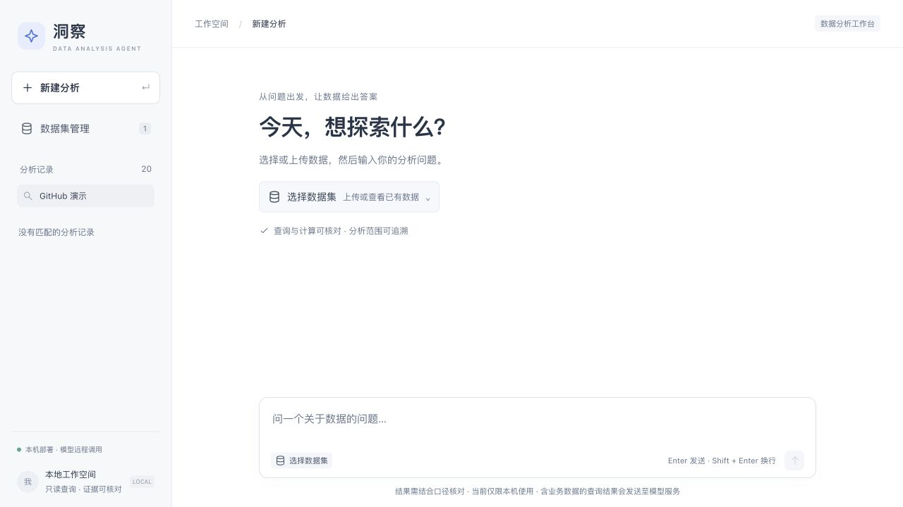
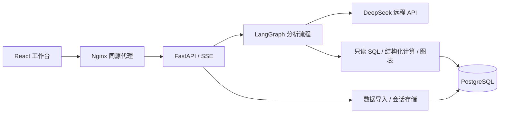

# 洞察 · 数据分析 Agent

基于 **LangGraph、FastAPI、DeepSeek、PostgreSQL 和 React** 的本地数据分析工作台。上传 CSV / Excel，用自然语言查询数据、分析趋势与维度贡献，通过图表和多轮追问继续探索。

[快速开始](#快速开始) · [演示案例](docs/demo.md) · [安装与排错](docs/quickstart.md) · [前端开发](web/README.md) · [贡献指南](CONTRIBUTING.md) · [MIT 许可证](LICENSE)



> 当前为本机演示项目。模型通过远程 API 调用，含业务数据的查询结果会发送至模型服务。尚无登录鉴权与租户隔离，请仅在本机使用。

## 核心功能

| 功能 | 当前支持 |
| --- | --- |
| 数据导入 | 上传 CSV、XLSX、XLS，预览字段及前 3 行数据；相同内容识别重复，不覆盖旧表 |
| 自然语言分析 | 查询 PostgreSQL 数据；单表可加总指标的趋势、两期或两群体比较、维度贡献拆解 |
| 多轮追问 | 保存分析范围，继续按渠道、品类等维度下钻；新问题重新查询数据 |
| 图表与流式回答 | 折线图、柱状图、真实执行进度、报告文字流式输出 |
| 查询与计算核对 | 只读 SQL、超时及行数限制；拆解明细与独立总额核对；可查看执行证据 |
| 会话持久化 | 历史问答和图表随 Docker 数据卷保留；中断或失败轮次标明状态 |

## 快速开始

准备 Git、正在运行的 Docker（含 Compose）和自己的 DeepSeek API Key。以下命令适用于 macOS / Linux；Windows PowerShell 步骤见[完整安装指南](docs/quickstart.md)。

```bash
git clone https://github.com/Hpyz-mc/data-analysis-agent.git
cd data-analysis-agent
cp -n .env.example .env
```

仓库为私有时，克隆需要有访问权限的 GitHub 账号。已有项目无需重新克隆；`cp -n` 保留已有配置。

编辑 `.env`，填写 `LLM_API_KEY`，确认 `LLM_API_ID` 是账号可调用的模型，并将三个 `DOCKER_*_PASSWORD` 占位符替换为各不相同的 URL 安全密码。Docker 会配置独立数据库，首次使用无需安装本机 PostgreSQL。配置解释和密码生成命令见[安装指南](docs/quickstart.md#配置环境)。

```bash
docker compose config --quiet
docker compose up -d --build
docker compose ps
```

打开 **[http://127.0.0.1:8501](http://127.0.0.1:8501)**，进入“数据集管理”，上传仓库内的 [`examples/data/sales_demo.csv`](examples/data/sales_demo.csv)，选择该数据开始分析，然后输入：

> 分析 2026 年 1 至 3 月的月度销售额走势，销售额按 sales_amount 求和，并生成折线图。

示例为 27 行合成数据，1、2、3 月销售额应分别为 **666,000、652,300、702,600**。具体步骤、字段口径和追问案例见[演示指南](docs/demo.md)。实际文字回答可能随模型变化，应核对数字和执行证据。

## 演示效果

以下截图来自本地工作台已有的合成数据分析记录，使用内置 `demo_ecommerce_orders` 表；附带 CSV 采用同一生成规则，上传后的表名由系统分配。


可以接着提问“2 月比 1 月销售额下降多少？按渠道拆解变化来源”，再继续问“线下门店按品类拆解”。明确指标、比较基准和维度，有助于得到可核对的分析结果。

## 技术架构



分析账号只读查询业务表；平台写入账号负责数据导入和会话保存。Python 工具接受结构化计算参数，不执行模型生成的任意 Python 代码。图表和数据库分别保存在 Docker 命名数据卷中。

```text
app/                  后端、分析流程、工具和会话存储
web/                  React + TypeScript 工作台
docker/               数据库初始化、迁移和示例脚本
tests/                后端与回归测试
examples/data/        可上传体验的合成数据
docs/                 安装、演示、截图及开发记录
examples/sql/         手动数据库演示与历史测试数据
scripts/              真实模型验收与 Token 测试脚本
outputs/              运行时图表和本地测试结果（不提交）
.github/              CI、Issue 和 PR 模板
compose.yaml          本机部署入口
```

## 开发与验证

后端镜像使用 Python 3.12，前端镜像使用 Node 22。使用相应环境安装依赖后，在项目根目录运行：

```bash
python -m pip install -r requirements.txt
python -m unittest discover -s tests -v
```

后端测试使用模拟依赖，不要求真实模型或数据库；测试通过不等于模型回答准确性通过。前端构建及客户端检查见 [`web/README.md`](web/README.md)。首次运行推荐 Docker；已有安装升级见[升级与维护](docs/quickstart.md#升级与维护)。

## 已知限制

- 分析以单表、可加总指标为主；未实现跨表关联、均值/比率归因、因果识别、复杂预测或通用统计建模。
- 导入上限为 20 MB、200 列、50,000 行；超过行数会截断并提示。SQL 返回上限为 100 行；图表最多 30 个数据点。汇总查询可以分析更大的原表。
- 自定义字段的粒度、聚合方式和业务口径需要用户确认；维度贡献解释变化来源，不证明因果。
- 证据检查和成功状态不能保证报告每句话都正确；报告中断时会保留已取得的可用结果并标明部分完成。
- 没有自动备份。永久删除会话或删除 Docker 数据卷会造成数据丢失。

## 文档与反馈

- [首次安装、配置、维护及故障排查](docs/quickstart.md)
- [合成数据演示与预期结果](docs/demo.md)
- [详细实现说明与历史开发记录](docs/development-notes.md)
- [前端开发与客户端检查](web/README.md)
- [贡献、测试和提交方式](CONTRIBUTING.md)
- [历史验收记录索引](docs/archive/README.md)
- [变更记录与发布准备](CHANGELOG.md)

欢迎通过 [Issues](https://github.com/Hpyz-mc/data-analysis-agent/issues) 反馈。请附上复现步骤、运行环境和脱敏错误信息，勿提交真实密钥、连接串或业务数据。

本项目采用 [MIT License](LICENSE)。
