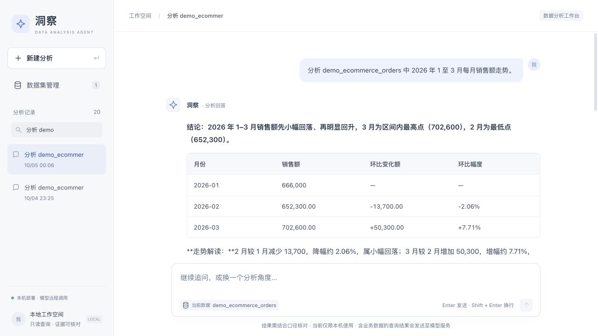
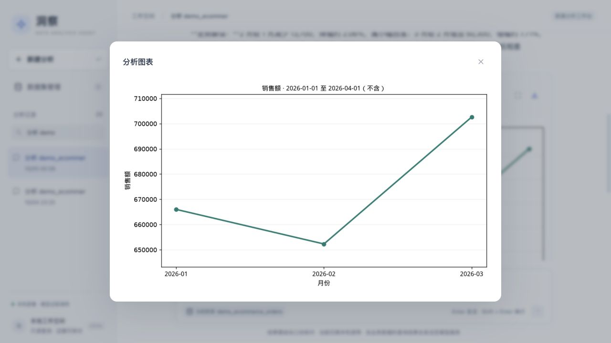

# 用合成销售数据体验一次完整分析

使用 [`examples/data/sales_demo.csv`](../examples/data/sales_demo.csv)。该 CSV 按 [`DatasetImporter.load_preset`](../app/tools/dataset_importer.py) 中的内置演示规则生成，包含 2026 年 1–3 月、3 个渠道、3 个品类，共 **27 行、7 列**。数据完全合成，不代表真实企业销售情况。

## 字段与口径

| 字段 | 含义 | 计算注意事项 |
| --- | --- | --- |
| `order_date` | 月度汇总记录日期，每月 15 日 | 按自然月汇总，不代表日级订单明细 |
| `channel` | 线上商城、线下门店、第三方平台 | 可用于渠道拆解 |
| `category` | 电脑、家电、服饰 | 可在选定渠道中继续拆解 |
| `sales_amount` | 渠道 × 品类 × 月的销售额，单位为元 | 可按同口径求和 |
| `order_count` | 合成订单数，按该行销售额除以 500 向下取整 | 行间可加总，仅为演示用途 |
| `stockout_days` | 演示供货线索 | 同一渠道月份在不同品类重复，不能跨品类相加为自然日 |
| `supply_status` | 正常 / 供应链断货 | 关联线索不能证明销售变化的因果原因 |

## 上传并选择数据

按[安装指南](quickstart.md)启动后，进入“数据集管理”，选择 CSV 并确认上传。预期导入 27 行、7 列。选择该数据开始分析，后端会使用实际分配的表名，无需手工创建数据库表。

## 第一步：查看月度走势

输入：

> 分析 2026 年 1 至 3 月的月度销售额走势，销售额按 sales_amount 求和，并生成折线图。

应核对的结果：

| 月份 | 销售额（元） | 较上月变化额（元） | 较上月变化率 |
| --- | ---: | ---: | ---: |
| 2026-01 | 666,000 | — | — |
| 2026-02 | 652,300 | -13,700 | 约 -2.06% |
| 2026-03 | 702,600 | +50,300 | 约 +7.71% |

模型文字可能不同，应以查询、计算和图表数字核对。只收到部分文字或 HTTP 200 不能说明该轮完成，应查看最终状态。

截图来自本机已有内置 `demo_ecommerce_orders` 表的分析历史，拍摄于 2026-10-05；CSV 使用同一合成规则，上传后的表名不同。截图展示一次已有分析结果，不是对所有模型和问题的通过保证。

## 第二步：按渠道拆解

在同一会话追问：

> 2 月比 1 月销售额下降多少？按渠道拆解变化来源，生成贡献图。

| 渠道 | 1 月销售额 | 2 月销售额 | 变化额 |
| --- | ---: | ---: | ---: |
| 线上商城 | 306,000 | 321,300 | +15,300 |
| 线下门店 | 200,000 | 163,000 | -37,000 |
| 第三方平台 | 160,000 | 168,000 | +8,000 |
| 合计 | 666,000 | 652,300 | -13,700 |

线下门店下降 37,000 元，其他两个渠道合计增长 23,300 元，抵消部分降幅。贡献率按总体净变化额计算，不是各渠道自己的增长率；存在抵消时，贡献率可超过 100% 或为负。

## 第三步：继续下钻

> 线下门店继续按品类拆解，沿用 2 月与 1 月的比较范围。

预期电脑、家电、服饰分别变化 **-20,350、-11,100、-5,550 元**，合计 **-37,000 元**。应核对范围仍为线下门店及原来的两个时期。

渠道和品类数字由合成规则确定，是复现时的核对目标；模型能否完成每项要求还需要实际验证。若要求澄清，补充指标、时间范围和维度后继续；如果标记部分完成，按提示修正，不把已有图表当作完整诊断。

## 从 API 核对

默认 API 文档位于 <http://127.0.0.1:8001/docs>。调用 `POST /api/v1/analyze` 时，将上传结果的实际 `table_name` 写进问题，并在追问中携带同一个 `session_id`。

查看 `plan`、`steps`、`finished`、`charts` 及 `usage`；后端会核对拆解明细与独立总额。分析次数和模型重试会产生实际用量，`usage` 缺失时不能把消耗估为零。
